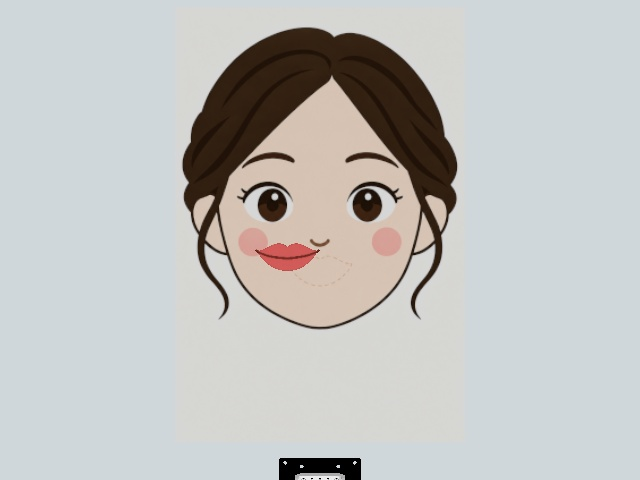

# まず理解するためのガイド

## 何をやったのか

福笑いの「口」だけをロボットで押して合わせます。つかむ動作ではありません。目は盤面に描かれた固定画像です。シミュレーション内で撮ったカメラ画像と、ロボットの関節角から次の動作を予測するAIを学習しました。

図：シミュレーションの開始配置。完成状態ではありません。

## 教師とモデルの違い

教師は画像から口の位置・向きを検出し、押す経路を計算するプログラムです。その動作を記録してACTという模倣学習モデルに学ばせます。モデルは教師の経路計算そのものを実行するのではなく、画像・関節・直前の履歴から関節角の列を予測します。教師の成功をそのままモデルの成功とは数えません。

## なぜ「中心が近い」だけでは失敗なのか

中心3mm、向き5度、輪郭2mm、接地高さ2mmという条件を同時に満たし、先端を盤面から40mm以上離して1秒保つ必要があります。口が回転していたり、先端で押さえたままだったりすると不合格です。高さによる離脱なので、上からの動画では先端が口の近くに見える場合があります。

## 結果の3つの数字

| 数字 | 何の結果か | 何が言えるか |
|---|---|---|
| 旧モデル1/5 | 調整にも使った開始条件 | 一度は全条件を満たした |
| 旧モデル0/5 | その後に固定して試した未使用条件 | 安定した再現性を確認できなかった |
| 最終モデル0/2 | 最後の変更後、既存の開始条件で比較 | 最後の変更で成功したとはいえない |

これらを合計して単一の成功率にしてはいけません。モデルと条件が異なります。動画の成功例は旧モデル、失敗例は最終モデルです。

## 何を改善しようとしたのか

押し終わった後に離れる動作が学習で出にくかったため、その区間を選ぶ割合を20%に増やしました。また予測した関節角を実行しやすい軌道に変換し、実際の関節が追いつくまで確認しました。しかし最終2試行では、位置や向きの誤差が残り、成功には至りませんでした。

## レポートで伝える主張

「安定して完成できた」という作品ではありません。画像による教師収集から学習、実行、厳しい評価までを作り、単発成功と再現性の限界を確かめた実験です。失敗原因の候補は接触後の向き補正、押す動作から離脱への切替、教師とモデルの実行時系列の差です。どれが主因かを断定する追加実験はしていません。
