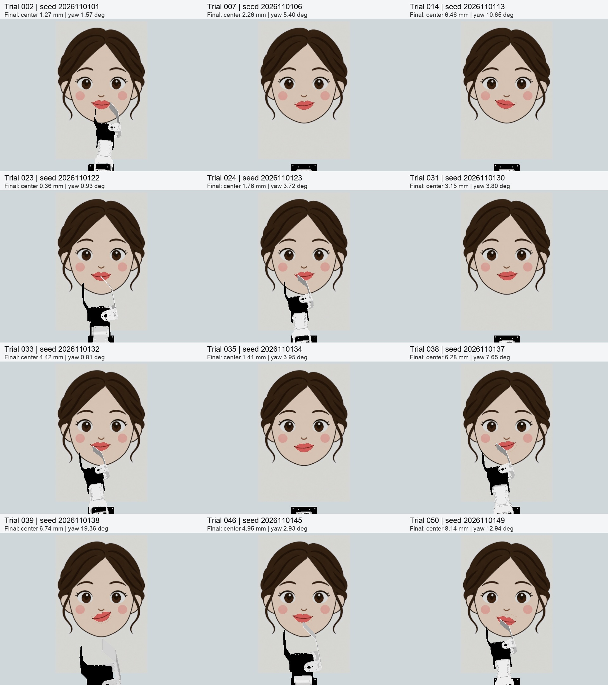

# 押して作るロボット福笑い
## 画像と関節履歴を使ったACT模倣学習

講義最終課題 / Gazeboシミュレーション / 2026年11月1日

### 結論
俯瞰画像から口のパーツを目標位置へ押すロボット福笑いを制作した。教師データの収集にはGPT-6 Lunaを活用し、ACTで操作を学習した。保存モデルを固定して50試行を実施した結果、最終状態で配置条件を満たしたのは12件、成功率は24%だった。接触後の向きの調整と、完成状態の安定した維持には課題が残った。

### 課題の目的
本課題で目指したのは、画像を見て薄いパーツを押し、位置と向きをそろえる操作を学習させることである。
CRANE+ V2の先端で「口」のパーツを押し、顔に描いたガイドへ位置と向きを合わせる。最後に先端を離し、配置が安定していることを確認する。つかんで運ぶ課題ではなく、接触しながら押す操作を扱う。

### 実験環境
| 項目 | 条件 |
|---|---|
| ロボット・環境 | CRANE+ V2 / ROS 2 Humble / Ignition Gazebo Fortress |
| 観測 | 俯瞰RGB 640×480、10 Hz、関節状態 |
| 盤面・口 | 45×30 cm / 66×28×8 mm、12 g |
| 開始条件 | 目標から3-6 cm、初期yaw 0度 |
| 学習・推論 | 講義のACT / Mac MPS |

実機への転移、未知の形状・摩擦・開始yawへの汎化は未検証である。シミュレータの物体座標は採点にだけ使い、教師の動作計算・モデル推論には渡さない。

# 1. 仕組みと自作部分

### 教師を作り、その動作から学習する
1. 画像から口の位置・向きを推定し、教師プログラムが押す経路を計算する。
2. 画像、関節状態、操作指令を時刻同期して記録する。
3. 品質と輪郭まで含めた従来条件を監査し、episode単位で学習と検証を分ける。
4. ACTが、画像・関節・因果的履歴から次の関節角の列を予測する。
5. 共通実行器で軌道を生成し、実際の追従を確認して採点する。

教師データ収集の運用をLunaに担当させた。教師の経路計算と、学習後のACT推論は別の制御方法である。教師の成功件数をモデルの成功件数として扱わない。

### 入力・出力
入力は現在のRGB、5関節、RGB由来の口の重心・軸・可視性、関節FKによる先端相対位置・高さ、直前の関節速度。補助特徴は計13次元で、未来情報や教師フェーズは推論に含めない。画像は固定領域を切り出し240×320にする。出力は5関節の絶対角。chunk長16で学習し、評価では8動作をまとめて実行する。

### 講義実装を利用した部分
ACT本体とLeRobotデータローダーは講義の固定ソースを利用した。ネットワーク自体の独自提案ではない。

### 本課題で実装した部分
福笑いのシーン・形状、画像ベース教師、同期記録、品質ゲート、マスク・変換、因果的特徴、抽出重み、推論とROSの接続、共通軌道・安全制約・追従ゲート、配置状態の採点と比較評価を実装した。AIコーディング支援を使用し、結果は保存記録で確認した。

# 2. データと成功条件

### 最終学習データ
| 項目 | 値 |
|---|---|
| ソース区間 | 全軌道25件 + 連続復帰区間2件 |
| 学習 / 検証区間 | 26 / 1（episode単位、重複なし） |
| 元フレーム数 | 57,175 |
| マスク後の学習 / 検証 | 52,852 / 3,457 |
| 除外フレーム | 学習832 + 検証34 = 866 |

復帰区間2件は、全区間の同期品質が不合格だった別軌道から切り出し、同期と保持を監査した連続区間である。新たな合格全軌道2件とは数えない。元130件と失敗記録は保持し、全件を輪郭まで含めた従来条件合格とは扱わない。欠損を詰めて不自然に連結せず、境界とpaddingをマスクする。

### 今回の評価で用いた成功条件
| 判定 | 合格条件 |
|---|---|
| 中心位置 | 目標から10mm以内 |
| 向き / 傾き | yaw20度以内 / tilt5度以内 |
| 接地高さ | 基準との差2mm以内 |
| 先端の離脱 | 盤面から40mm以上離れる |
| 最終保持 | 終了時まで全条件を1 simulation秒以上保持 |

最終状態が目標に近い位置・向きに配置されていることを成功とした。輪郭の完全な一致は求めない。保存観測の間隔が0.2秒を超えた場合、保持時間をリセットした。全50件を分母に含め、記録品質が不足したモデル失敗6件も失敗として扱った。

# 3. 改善実験と最終モデル

### 実行方法の差も調べた
教師の元軌道で成功しても、100msごとの指令へ単純に再構成すると失敗する場合があった。最終比較では、終点を保存して最大1 rad/sの共通関節軌道を生成した。固定盤面への貫入を限定的に高さ補正し、関節範囲と盤面余裕を確認した。動的な物体位置を使った修正ではない。

さらに、計画時刻の後も実測関節が終点の0.02 rad以内になるまで最大1秒待つ追従ゲートを使った。教師とモデルの時系列が完全に同一になったとまでは主張しない。

### 最後の変更：離脱・保持区間の抽出を増やす
接触付近を重視する従来の抽出設定では、離脱・保持・成功区間581フレームの抽出確率が0.392%だった。この区間の確率質量を20%へ変更した。データ・マスク・検証分割などは維持した。教師フェーズは学習時の抽出重みにだけ使った。

### 最終候補の学習設定
| 項目 | 設定 |
|---|---|
| 継続学習 | 既存モデルから6,000追加step |
| 保存モデル選択 | 追加2,250step時点（検証MAEで選択） |
| batch / KL / seed | 8 / 1 / 2026 |
| 学習率 / backbone | 1e-5 / 2e-6、cosine減衰 |
| 再読込task MAE | 0.012273 rad（60サンプル） |

MAEは関節動作の誤差であり、タスク成功率ではない。中心誤差だけが小さくても、向き・輪郭・離脱を満たす保証にはならない。

# 4. GPT-6 Lunaによる教師データ収集

### エージェントに担当させたこと
教師データを繰り返し収集する担当としてGPT-6 Luna（モデルID: gpt-6-luna）を使用した。Lunaには収集スクリプトの実行、ログ・採否の確認、失敗記録の保存、評価担当へのアームの引継ぎを担当させた。アームの同時操作を防ぐ排他制御も設けた。

口の画像推定から押す経路を計算するのは教師プログラムであり、Lunaが各制御周期に画像から関節角を直接生成したわけではない。Lunaはデータ作成工程を運用するエージェント、ACTはそのデータから操作を学ぶモデルとして役割を分けた。

### 本課題で確認できた実績
| 収集段階 | 記録で確認した内容 |
|---|---|
| 初期データの追加収集 | 41試行中30件を採用、11件を不採用として保存 |
| 採否を厳しく見直した後の収集 | 最終学習に用いる教師軌道25件の収集完了を記録 |
| 最終学習用の区間 | 全軌道25件と、別途監査した連続復帰区間2件 |

初期30件の採用は当時の条件によるもので、最終学習用25件と同じ母集団ではない。教師データの採否は保存記録と品質チェックで判定し、Lunaの完了報告だけで合格とはしなかった。

### 公開ベンチマークとの関係
OpenAIの公表値では、複数ツールを使うAutomationBenchでLuna（high）は前世代より5.4ポイント改善し、タスク当たりコストは58%低下した。長いソフトウェア開発課題を扱うDeepSWE 1.1ではLuna（max）が66.6%と報告されている［6］。これらは公表時の設定であり、今回と同一設定での測定ではない。

このようなツール実行能力は収集・検査・引継ぎの反復作業に役立つと考えた。実際に教師データの収集を任せられた一方、ロボットの物理操作を直接評価したベンチマークではない。他モデルや手動作業との同条件比較、作業時間・実費の測定は行っていないため、Lunaの優位性や費用削減効果を本課題で実証したとはいえない。

# 5. 評価結果と考察

### 最終状態で12/50件が成功
最終保存モデルと実行条件を固定し、教師データ・過去の評価記録にない開始seedで50試行を行った。各試行の上限は600 simulation秒とし、終了時の配置と直前1秒以上の保持を保存観測から判定した。

| 結果 | 件数 | 割合 |
|---|---|---|
| 成功 | 12/50 | 24% |
| 失敗 | 38/50 | 76% |

成功したのは第2・7・14・23・24・31・33・35・38・39・46・50試行である。成功とした12件は最終画像を目視でも確認し、口が目標付近に配置されていることから成功と判断した。次ページにその全12件を示す。

### 実験でそろえたこと
モデル重み、物理条件、共通関節軌道、盤面への貫入を避ける補正、追従確認、8動作ずつの実行を固定した。成功条件は今回の追加試行を始める前に決めたが、過去の探索結果を参考にしている。当初100件を予定し、途中結果を確認後に50件で終了したため、当初計画どおりの100件評価ではない。

モデル動作後の時間切れ・安全停止・追従停止を失敗に含めた。開始前の0画像・0モデル動作の通信障害は別記録に残して再開した。動作した失敗を成功するまで繰り返してはいない。過去の別モデル・別条件の成功件数は合算していない。

### 分かったことと残った課題
位置と向きをそろえて終われる試行を確認できた。一方、押し続けるうちに向きが崩れる、離脱や停止の切替が安定しないといった課題が残った。関節角の予測誤差が小さいだけでは、接触を伴うタスクの完成には直結しなかった。

今後は完成状態を認識して停止する処理や、離脱動作を学ぶデータの充実を検討したい。今回の24%は、この開始位置分布とシミュレーション環境での最終状態の数値判定である。全動画の統一的な目視監査、実機、未知の摩擦・形状・開始角度での評価は未実施である。

# 6. 成功12試行の最終状態

以下は、最終状態が成功条件を満たした全12件である。各画像の上に試行番号、最終中心誤差（mm）、最終の向きの誤差（度）を表示した。数値条件に加え、最終画像の目視でも配置を確認した。

# 7. 成果物・AI利用・出典

### 自作した部分と利用した部分
福笑いのシーンとパーツ、画像ベース教師、同期記録、データ品質確認、補助特徴、ROS接続、実行管理と評価を実装した。ACT本体とデータローダーは講義実装を利用した。開発にはAIコーディング支援を使い、教師データ収集の運用にGPT-6 Lunaを使用した。

### 成果物と再現可能性
コードにはシーン・教師・記録・変換・学習・推論・評価を含む。重み、元画像、データセット、生ログは同梱していないため、Repoだけで保存モデルの同一推論・独立再採点を完了できる構成ではない。原記録は開発環境で保持し、全50件の採点抜粋と成否一覧をevidenceに保存した。

最終画像を全50件、動画を保存方針に従って保持した。保存時にフレーム数・デコードの検証を行った。動画全体の目視審査とは区別している。

### 出典・記録
[1] Physical AI応用1講座「最終課題（10/19改訂版）」p.1・3・5。概要・目的・工夫点を記載するPDFと、独自の工夫・反省・考察について参照。
[2] matsuolab/pai_training。講義ACT・学習基盤。固定コミット b4d6b5459066a80433475a83567504988875248a。
[3] 講義LeRobotサブモジュール。固定コミット 768e36660d1408c71118a2760f831c037fbfa17d。
[4] ROS 2 Humble / Ignition Gazebo Fortress / CRANE+、AI-Robot-Book教材環境。第三者コード・素材・フォントの区分はTHIRD_PARTY.md。
[5] evidence/placement50-results.json、placement50-terminal-state-review.json、placement50-final-outcomes.csv。保存観測による最終判定、全50件の結果、観測SHA256。Luna収集記録の抜粋はevidence/luna-collection-summary.json。
[6] OpenAI, Introducing GPT-6 Sol and Luna, Professional work / Coding。2026年11月1日参照。AutomationBench・DeepSWEの公表値。https://openai.com/index/introducing-gpt-6-sol-and-luna/

公開ベンチマークは教師データ作成能力やロボット制御性能の直接評価ではない。報告された評価環境と今回のエージェント実行環境には差がある。
